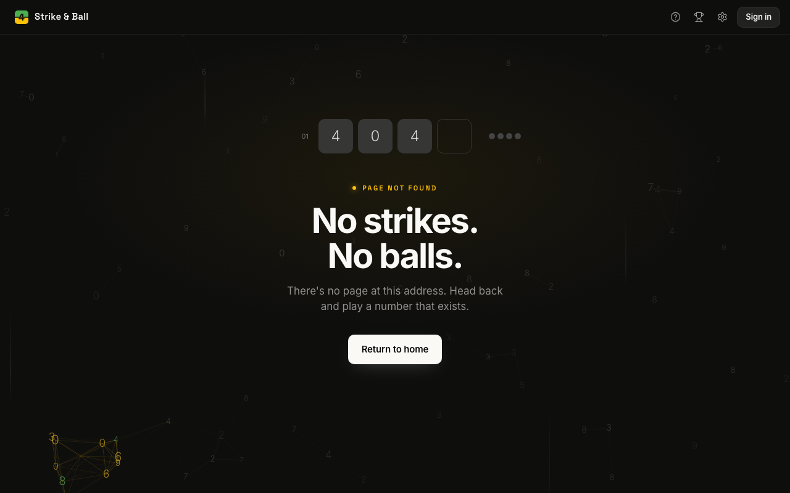
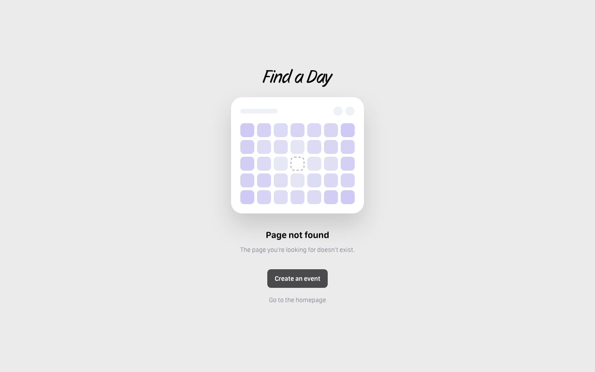
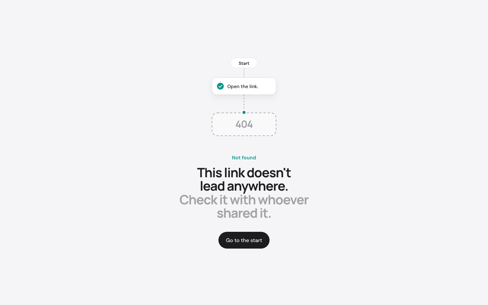

# /fallback404

**You built the pages. Let's do the missing ones.**

[](https://fallback404-beta.vercel.app)

`/fallback404` is a free Claude Code skill that finds the 404, loading and error pages your Next.js app is missing, including 404 pages that wrongly answer HTTP 200, and designs on-brand ones with you on a picker page in your browser. It writes them on a new git branch and never commits.

## Install

```bash
/plugin marketplace add Frklin/fallback404-skill
/plugin install fallback404@fallback404
```

On Claude Code 2.1.275 or later, one line does both:

```bash
/plugin install fallback404 --marketplace Frklin/fallback404-skill
```

Then, inside your Next.js app, type `/404s`, or ask Claude: *add my missing 404 pages*.

<details>
<summary>No plugins? Copy the skill directly.</summary>

```bash
git clone https://github.com/Frklin/fallback404-skill
rsync -a --exclude '.DS_Store' fallback404-skill/skills/fallback404/ ~/.claude/skills/fallback404/
```

Restart Claude Code after copying.
</details>

<details>
<summary>Update or remove it.</summary>

```bash
/plugin marketplace update fallback404
/plugin uninstall fallback404@fallback404
```

A copy in `~/.claude/skills/fallback404/` is removed by deleting that folder.
</details>

### Other agents

Any agent that reads [Agent Skills](https://agentskills.io) (a `SKILL.md` in a skills folder) and runs shell commands can use it. Install it with the [`skills` CLI](https://github.com/vercel-labs/skills), from your Next.js app's folder:

```bash
npx skills add https://github.com/Frklin/fallback404-skill --skill fallback404
```

It copies the skill to `.agents/skills/fallback404` in the project, which Codex, opencode and Gemini CLI read, and links it into `.claude/skills/` for Claude Code. Add `-g` to install it for your user instead of one project, `-a codex` to pick an agent.

Codex also installs it as a plugin, from the same marketplace:

```bash
codex plugin marketplace add Frklin/fallback404-skill
codex plugin add fallback404@fallback404
```

| Agent | Install | Tested |
| --- | --- | --- |
| Claude Code | the plugin above, or `skills` CLI | whole run, picker included |
| Codex CLI | the plugin above, or `skills` CLI | plugin install, skill install, preflight and scan; not the picker or the write phases |
| opencode, Gemini CLI | `skills` CLI | installs; not run |

`SKILL.md` names its folder `${CLAUDE_SKILL_DIR}`. Claude Code fills that in; other agents are told to use the folder's absolute path.

Opening this repo in an agent also works: `.agents/skills/`, `.claude/skills/` and `.opencode/skills/` each hold a link to `skills/fallback404/`. On Windows, git needs `core.symlinks` (Developer Mode or an admin shell) to check those links out; without it they are plain text files and only that opening-the-repo case is affected, not the installs above.

## Use it

From your Next.js app's folder, in Claude Code:

```text
/404s
```

Or ask Claude in your own words: *add my missing 404 pages*, *fix the soft 404s*, *give /dashboard a loading state*, *redesign my 404 page*. Text after the command goes along too: `/404s fix the soft 404s`.

What happens:

1. **Scan.** It reads your App Router tree and finds missing `not-found`, `loading` and `error` files, and dynamic routes that answer 200 for records that don't exist.
2. **Coverage.** A picker page opens in your browser with every 404, loading and error flow of your app, screenshots of your current 404 pages, and a choice per row: create, keep, redesign or fix.
3. **Design.** For what you chose, a few options per step in your colors and fonts: a logo if you have none, a mascot or a motif built from your own components, the loader motion, the 404 page. You pick, or reject with a note and get a new round.
4. **Write.** Files go on a new branch, `fallback404/<date>`, in one components folder plus thin route files. A change to a file you wrote is shown as a diff first and needs your yes.
5. **Check.** It checks the output rules below, type-checks, screenshots every state in light and dark mode and, if you agree, runs a production build to confirm each 404 answers HTTP 404. Nothing is committed: review with `git diff` and commit when you're happy.

## What it makes

Real sites whose 404 page belongs to them: the site's own colors, fonts and components, and one idea from what the site does. This is the bar the skill designs toward on yours.

| [Strike & Ball](https://www.strikeandball.com/) | [Find a Day](https://www.findaday.app/) | [Step by Step](https://step-by-step-kappa.vercel.app/) |
| --- | --- | --- |
|  |  |  |
| A daily number-guessing game. Its 404 is a round with no strikes and no balls. | Pick the day that works for everyone. Its 404 is a calendar with one empty slot. | Instructions drawn as a flow of steps. Its 404 is a step that is not there. |

## What lands on the branch

```text
app/
  global-error.tsx                ← required here; renders its own <html> and <body>
  not-found.tsx                   ← wrapper, imports from the folder
  error.tsx                       ← wrapper
  loading.tsx                     ← wrapper
  products/[id]/not-found.tsx     ← wrapper, only where a section needs its own
  fallback404-preview/page.tsx    ← every state on one page, dev only

components/fallback404/
  illustrations/                  ← MissingStep, BrokenStep…
  states/                         ← the full 404, error and loading screens
  copy.ts                         ← all texts in one file
  fallback404.css                 ← motion classes, instead of editing globals.css
  manifest.json                   ← which route uses which state
```

Only the files you picked are written. Your own `globals.css` and `.gitignore` are never edited.

## How it works

- The skill is a `SKILL.md` playbook plus zero-dependency Node scripts (`scan`, `coverage`, `picker`, `branch`, `write`, `check`, `shoot`…) that run inside your project.
- `scan` parses your routes, `proxy.ts` or `middleware.ts` and data helpers with a vendored `@babel/parser` to find missing states and soft 404s.
- Each script prints one JSON line, so a run can be resumed: progress lives in `.fallback404/`, which is kept out of git through `.git/info/exclude`.
- The picker page is a small hosted service the skill talks to: it receives previews and sends back your choice. The files themselves are written locally.
- `check` enforces the output rules before you see the result.

## What leaves your machine

Your source code never does. The picker page gets only baked SVGs, screenshots (of the generated pages and of your site's current 404 pages at made-up URLs), titles, one-line descriptions, route paths and file names. Diffs stay in your terminal.

## Output rules

Every page it writes follows these, and a checker enforces them before you see the result:

- A 404 answers HTTP 404. Never 200, never a redirect to home.
- Every color comes from a token and works in light and dark mode.
- Illustrations are decorative SVG (`aria-hidden`, ids unique per instance); the message is real HTML text.
- Motion stops under `prefers-reduced-motion`.
- Loaders have `role="status"` or `aria-busy` with a text label, stay small and inlined, and cause no layout shift.

Details: [`skills/fallback404/reference/output-rules.md`](skills/fallback404/reference/output-rules.md).

## Requirements

- [Claude Code](https://claude.com/claude-code), or another agent that reads Agent Skills (see [Other agents](#other-agents))
- Node.js 20+
- A Next.js App Router app in a git repo (measured on Next.js 16.3 and 16.4)
- Optional: a one-time headless Chromium download (about 105 MB) for screenshots. The skill asks before downloading; without it, everything still runs except the screenshots and the visual check.

## What's in this repo

- `skills/fallback404/`: the skill (`SKILL.md`), its reference notes, the house style (characters, layouts, motion) and the Node scripts it runs
- `skills/404s/`: the `/404s` shortcut, which runs `fallback404` with whatever you type after it
- `.claude-plugin/`: Claude Code plugin manifest and marketplace catalog (Codex reads the same catalog)
- `.codex-plugin/`: Codex plugin manifest
- `plugin.json`: the same manifest in the [Agent Plugins](https://agent-plugins.org) format
- `.agents/`, `.claude/`, `.opencode/`: links to `skills/fallback404/`, so each agent finds the skill when it opens this repo
- `assets/`: images for this README
- `.github/`: issue templates
- `LICENSE`: MIT

## Credits

- [`@babel/parser`](https://github.com/babel/babel/tree/main/packages/babel-parser) 7.29.9, vendored unmodified under its own MIT license (`skills/fallback404/scripts/vendor/`), reads TypeScript and JSX in projects that don't have it installed.
- [Playwright](https://playwright.dev) takes the screenshots and runs the visual check.
- Repo layout and README shape follow [latent-spaces/brag](https://github.com/latent-spaces/brag).

## Contributing

Issues and ideas are welcome: [open an issue](https://github.com/Frklin/fallback404-skill/issues/new/choose). The code is mirrored from a private repo where its tests live, so pull requests are ported over by hand, with credit.

## Star History

[](https://star-history.com/#Frklin/fallback404-skill&Date)

## License

[MIT](LICENSE)
