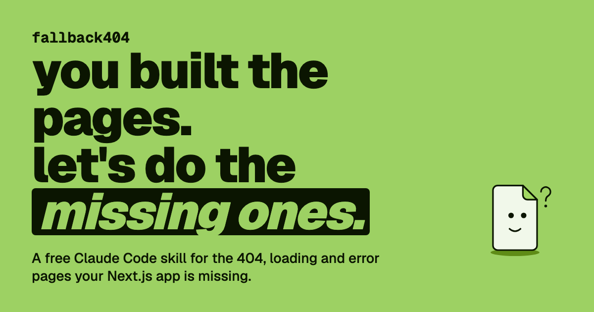

# /fallback404

**You built the pages. Let's do the missing ones.**

[](https://fallback404-beta.vercel.app)

`/fallback404` is a free Claude Code skill that finds the 404, loading and error pages your Next.js app is missing, including 404 pages that wrongly answer HTTP 200, and designs on-brand ones with you on a picker page in your browser. It writes them on a new git branch and never commits.

## Install

```bash
/plugin marketplace add Frklin/fallback404-skill
/plugin install fallback404@fallback404
```

On Claude Code 2.1.275 or later, one line does both:

```bash
/plugin install fallback404 --marketplace Frklin/fallback404-skill
```

Then, inside your Next.js app, ask Claude: *add my missing 404 pages*.

<details>
<summary>No plugins? Copy the skill directly.</summary>

```bash
git clone https://github.com/Frklin/fallback404-skill
rsync -a --exclude '.DS_Store' fallback404-skill/skills/fallback404/ ~/.claude/skills/fallback404/
```

Restart Claude Code after copying.
</details>

## Use it

From your Next.js app's folder, ask Claude:

```text
add my missing 404 pages
```

Or be specific: *fix the soft 404s*, *give /dashboard a loading state*, *redesign my 404 page*.

What happens:

1. **Scan.** It reads your App Router tree and finds missing `not-found`, `loading` and `error` files, and dynamic routes that answer 200 for records that don't exist.
2. **Coverage.** A picker page opens in your browser with every 404, loading and error flow of your app, screenshots of your current 404 pages, and a choice per row: create, keep, redesign or fix.
3. **Design.** For what you chose, a few options per step in your colors and fonts: a logo if you have none, a mascot or a motif built from your own components, the loader motion, the 404 page. You pick, or reject with a note and get a new round.
4. **Write.** Files go on a new branch, `fallback404/<date>`, in one components folder plus thin route files. A change to a file you wrote is shown as a diff first and needs your yes.
5. **Check.** It checks the output rules below, type-checks, screenshots every state in light and dark mode and, if you agree, runs a production build to confirm each 404 answers HTTP 404. Nothing is committed: review with `git diff` and commit when you're happy.

## What leaves your machine

Your source code never does. The picker page gets only baked SVGs, screenshots (of the generated pages and of your site's current 404 pages at made-up URLs), titles, one-line descriptions, route paths and file names. Diffs stay in your terminal.

## Output rules

Every page it writes follows these, and a checker enforces them before you see the result:

- A 404 answers HTTP 404. Never 200, never a redirect to home.
- Every color comes from a token and works in light and dark mode.
- Illustrations are decorative SVG (`aria-hidden`, ids unique per instance); the message is real HTML text.
- Motion stops under `prefers-reduced-motion`.
- Loaders have `role="status"` or `aria-busy` with a text label, stay small and inlined, and cause no layout shift.

Details: [`skills/fallback404/reference/output-rules.md`](skills/fallback404/reference/output-rules.md).

## Requirements

- [Claude Code](https://claude.com/claude-code)
- Node.js 20+
- A Next.js App Router app in a git repo (measured on Next.js 16.3 and 16.4)
- Optional: a one-time headless Chromium download (about 105 MB) for screenshots. The skill asks before downloading; without it, everything still runs except the screenshots and the visual check.

## What's in this repo

- `skills/fallback404/`: the skill (`SKILL.md`), its reference notes, the house style and the zero-dependency Node scripts it runs
- `.claude-plugin/`: plugin manifest and marketplace catalog
- `assets/`: images for this README

## Contributing

Issues and ideas are welcome: [open an issue](https://github.com/Frklin/fallback404-skill/issues). The code is mirrored from a private repo where its tests live, so pull requests are ported over by hand, with credit.

## License

[MIT](LICENSE)
